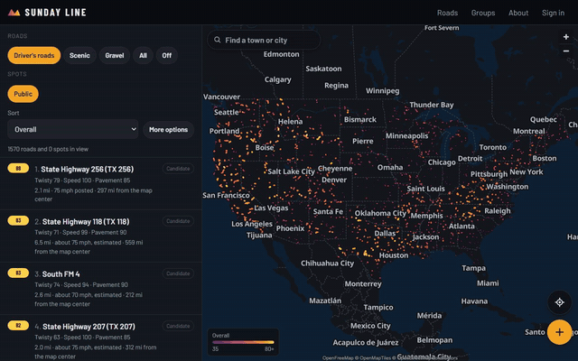
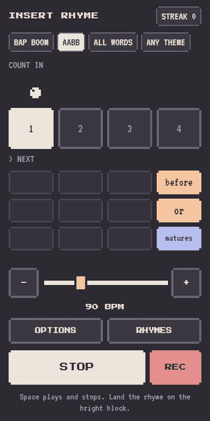
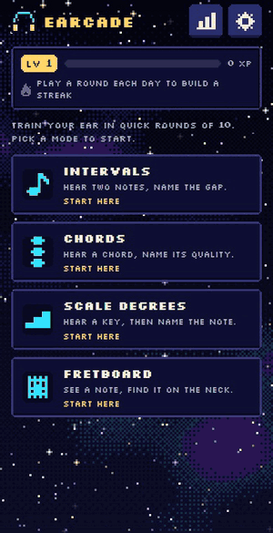
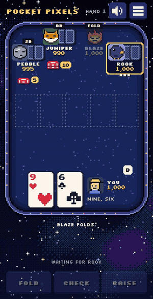
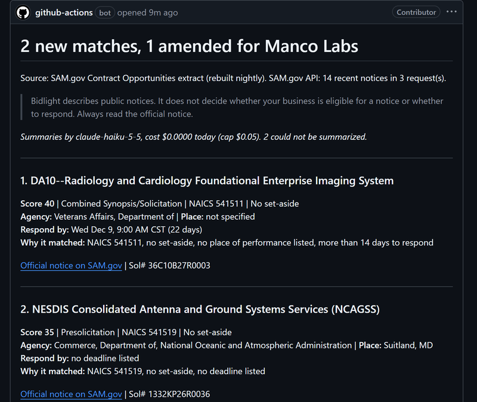

Full-stack developer in Shreveport, LA. I build web apps, games, and tools with Claude Code and launch them live. Founder of Manco Labs.

[mancolabs.dev](https://mancolabs.dev) · [The Lab](https://mancolabs.dev/lab/)

### Sunday Line

Find great local driving roads and organize meets with your car or bike group.

[Live demo](https://sundayline.app) · [Code](https://github.com/ethanmanco/sunday-line)

### Insert Rhyme

Free 8-bit freestyle rap practice. Pick a beat, watch the ball bounce across each bar, and land your rhymes on the bright blocks. No accounts, no ads, nothing to pay for, and nothing leaves your device.

[Live demo](https://ethanmanco.github.io/insert-rhyme/) · [Code](https://github.com/ethanmanco/insert-rhyme)

### Steplab

A simple beat maker in your browser, laid out like FL Studio with the same shortcuts, so what you learn carries over: make drum loops and melodies, then arrange them into a song.

[Live demo](https://ethanmanco.github.io/steplab/) · [Code](https://github.com/ethanmanco/steplab)

### Sixline

A guitar fretboard for people who read tab: pick a chord, scale, or arpeggio in any key to see it on the neck, hear it, and read it as tab.

[Live demo](https://ethanmanco.github.io/sixline/) · [Code](https://github.com/ethanmanco/sixline)

### Earcade

An 8-bit ear and theory trainer for your phone: name intervals, chords, and scale degrees by ear, or find notes on the fretboard, in quick rounds of 10.

[Live demo](https://ethanmanco.github.io/earcade/) · [Code](https://github.com/ethanmanco/earcade)

### Pocket Pixels

8-bit Texas Hold'em for your phone: play computer opponents with their own styles, or send friends a link to your table, with play chips only.

[Live demo](https://ethanmanco.github.io/pocket-pixels/) · [Code](https://github.com/ethanmanco/pocket-pixels)

### Cursor Playground

Pick from 35 colorful cursor effects, stack as many as you like, tweak them, and share a link to what you made.

[Live demo](https://ethanmanco.github.io/cursor-playground/) · [Code](https://github.com/ethanmanco/cursor-playground)

### Bidlight

A daily radar for federal contract opportunities: it checks every active SAM.gov notice, keeps the ones that fit a small business's profile, scores them, and posts a short digest as a GitHub issue.

[Example digest](https://github.com/ethanmanco/bidlight/issues/2) · [Code](https://github.com/ethanmanco/bidlight)

---

Each project is built with Claude Code. I designed, directed, reviewed, and tested it.
